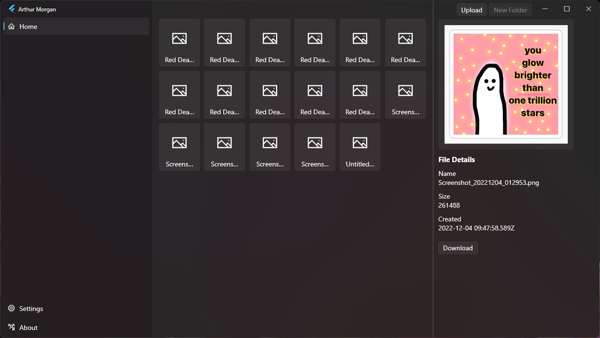

# Arthur Morgan

<a title="Made with Flutter" href="https://github.com/flutter">
  
</a>
<a title="Made with Fluent Design" href="https://github.com/bdlukaa/fluent_ui">
  
</a>
<a>
  
</a>

Arthur Morgan is an experimental Flutter desktop client for storing encrypted files in Google Drive. It signs in with Google OAuth, creates or reuses an `ArthurMorgan` folder in Drive, encrypts local files before upload, and decrypts files locally when previewing or downloading them.



## What it does

- Signs in to a Google account with OAuth 2.0.
- Uses the Google Drive API v3 to list, upload, and download files.
- Creates an `ArthurMorgan` folder in Drive, either at Drive root or inside a user-selected parent folder.
- Stores a small verification file named `arthurmorgan` to check the encryption password on later launches.
- Encrypts file contents before upload.
- Encrypts uploaded filenames before storing them in Drive.
- Decrypts filenames locally for the in-app file grid.
- Supports multiple-file upload from the title bar upload button.
- Supports single-file download to the app documents directory.
- Supports image preview by downloading and decrypting image files in memory.
- Provides a Fluent UI desktop interface with custom window controls and configurable window effects.

## Current status

This project is a work in progress. The repository contains Flutter platform folders for Android, iOS, Linux, macOS, Windows, and web, but the app code is currently desktop-oriented. It uses `dart:io`, desktop window APIs, local browser OAuth redirects, and desktop file picking behavior.

## Implemented and planned features

| Feature | Status |
| --- | --- |
| Google OAuth sign-in | Implemented |
| Remember OAuth credentials locally | Implemented |
| Select Drive root or a named parent folder | Implemented |
| Initialize an `ArthurMorgan` Drive folder | Implemented |
| Password verification for an existing folder | Implemented |
| Encrypt file contents | Implemented |
| Encrypt filenames | Implemented |
| Upload one or more files | Implemented |
| List encrypted Drive files with decrypted names | Implemented |
| Download a single file | Implemented |
| Preview decrypted image files | Implemented |
| Logout | Implemented |
| Create folders from the UI | Not implemented |
| Download multiple files | Not implemented |
| Drive thumbnails | Not implemented |
| Production-grade encryption/key management | Not implemented |

## How storage works

On first setup, Arthur Morgan creates a folder named `ArthurMorgan` in Google Drive. If the user enters a custom parent folder name, the app looks for that folder and creates or reads `ArthurMorgan` inside it. Otherwise, it uses the Drive root.

The setup password is used to create an AES key. The app stores an encrypted verification string in a Drive file named `arthurmorgan`. On later launches, it downloads that verification file and checks the entered password before decrypting the file list.

Uploaded files are encrypted locally first, then uploaded to Drive. Downloaded files are decrypted locally and saved under:

```text
<application documents directory>/ArthurMorgan/Downloads/
```

## Security notes

Arthur Morgan should be treated as experimental software, not as a production backup or password manager.

- The app requests the full Google Drive OAuth scope: `https://www.googleapis.com/auth/drive`.
- Encryption is implemented locally with AES-CBC through the current Dart dependencies.
- The password is padded into a 32-character key by the app code.
- The password is not recoverable from the app. Losing it means the uploaded encrypted files cannot be decrypted by this client.
- The encryption design has not been audited.
- OAuth credentials are cached with `shared_preferences`.

## Requirements

- Flutter SDK compatible with Dart `>=2.18.4 <3.0.0`.
- A Google Cloud project with the Google Drive API enabled.
- OAuth credentials for a Desktop app.
- Desktop build tools for your target platform.

For Windows development, install the Flutter Windows desktop prerequisites. For Linux or macOS, install the matching Flutter desktop toolchain and any plugin-specific native dependencies required by Flutter.

## Google Cloud setup

1. Open the Google Cloud Console.
2. Create or select a project.
3. Enable **Google Drive API** for the project.
4. Configure the OAuth consent screen.
5. Create OAuth client credentials with application type **Desktop app**.
6. Download the OAuth client JSON file.
7. Place the JSON file in the app's working directory before launching Arthur Morgan.

The app scans the current working directory for a `.json` file and reads `installed.client_id` and `installed.client_secret` from it. Keep only the intended OAuth client JSON beside the executable or in the project root when running from source.

If your Google Cloud app is still in testing mode, add your Google account as a test user on the OAuth consent screen.

## Running from source

Clone the repository and install dependencies:

```bash
git clone https://github.com/BeLikeSohan/arthurmorgan.git
cd arthurmorgan
flutter pub get
```

Put the downloaded OAuth desktop client JSON file in the repository root, then run the desktop app:

```bash
flutter run -d windows
```

Use the matching device id for another desktop target:

```bash
flutter run -d linux
flutter run -d macos
```

## Building

Build a release binary for your platform:

```bash
flutter build windows
flutter build linux
flutter build macos
```

After building, place the Google OAuth desktop client JSON file next to the executable or launch the app from a working directory that contains the JSON file.

## Basic usage

1. Start the app with the OAuth client JSON available in the working directory.
2. Click **Sign in with Google Account** and complete the browser-based OAuth flow.
3. Choose where Arthur Morgan should look for its Drive folder. Leave the folder name empty to use Drive root.
4. For a new Drive setup, choose **Setup Arthur Morgan** and enter an encryption password.
5. For an existing setup, enter the same password used when the folder was created.
6. Use **Upload** in the title bar to pick one or more files.
7. Select a file in the grid to view details, preview images, or download the decrypted file.

## Project structure

```text
lib/
  main.dart                         App bootstrap, providers, navigation, OAuth JSON loading
  functions/
    googleoauthmanager.dart         Browser OAuth flow and OAuth client creation
    gdrivemanager.dart              Google Drive API operations
    filehandler.dart                File picking, encryption, decryption, password verification
    preferencesmanager.dart         Local persisted settings and OAuth credential cache
    stylehandler.dart               Desktop window effect handling
  providers/                        ChangeNotifier state for auth, Drive, settings, sheets, tasks
  pages/                            Sign-in, dashboard, and settings UI
  widgets/                          Custom title bar and shared UI widgets
  models/                           File metadata models
```

## Development notes

- State management is based on `provider`.
- The UI uses `fluent_ui`.
- Google API access is provided by `googleapis` and `oauth2`.
- Local file selection uses `file_picker`.
- Window effects use `flutter_acrylic` and `window_manager`.
- The default app theme is currently dark.

## Known limitations

- The **New Folder** button is disabled.
- Downloads are single-file only.
- There is no delete, rename, move, search, or conflict handling UI.
- Image previews require downloading and decrypting the file first.
- Folder lookup is name-based, so duplicate Google Drive folder names may cause ambiguous behavior.
- The app currently picks the first JSON-looking file it finds in the working directory.
- Some settings UI is present but not fully connected to app-wide theme behavior.
